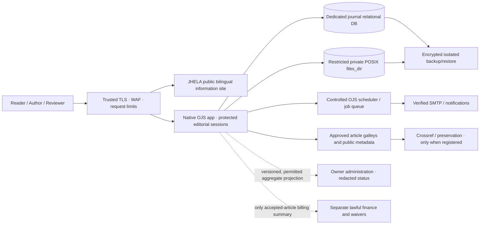

# JHELA — Future-Scale Publishing Architecture, Migration and Evidence Dossier
**Architecture Decision Record JHELA-ADR-001 · 16 October 2026 · Target baseline v1.0**  
**Owner intent:** Design the journal for future international excellence; do not cap features at the present host.  
**Canonical source:** `migration/bertina-linux6` at `drrezazadeh65/drjavadrezazadeh.com`  
**Machine contract:** `platform/jhela-target-architecture-v1.json`  
**Status:** APPROVED DESIGN DIRECTION FROM OWNER; **not provisioned, migrated or live-certified**.

## Executive decision

JHELA must be engineered as a distinct international scholarly publishing institution rather than a subsection of the owner's educational/commerce website. The public bilingual journal information site remains at `drjavadrezazadeh.com/journal/` and the reserved editorial application host remains `journal.drjavadrezazadeh.com`. The preferred editorial core is the official, supported Open Journal Systems (OJS) 3.5 series, kept within its supported extension boundaries. The intended move to larger independent hosting must **not** require changing journal public URLs, author identity contracts, article metadata or the scientific editorial workflow.

The owner's planned five-gigabyte disk increase for 17 October 2026 is a **transitional capacity increment**, not a verified free-space measurement and not a design limit. No deployment gate changes from extra storage alone.

A single, carefully managed native OJS editorial system is preferable to building a new microservice-based manuscript platform. Independence is achieved through bounded databases, identity, storage, operational permissions and integration interfaces, not by rewriting proven peer-review functions. Cross-service additions—finance, security analytics, institutional partnerships, author services—must be outside the confidential editorial core unless an officially supported OJS plugin/API has been tested.

## Target topology and trust boundaries



The diagram describes **future target zones**, not installed infrastructure. Two principles dominate the trust model: unpublished manuscript data remains inside native OJS and its protected database/file store; published scholarly outputs and limited consented metadata are the only broadly discoverable resources.

### Domain and URL governance

- `https://drjavadrezazadeh.com/journal/`: enduring public bilingual discovery and ethical policies; separate `journal/sitemap.xml`; never serves review drafts or unpublished files.
- `https://journal.drjavadrezazadeh.com`: canonical native OJS workflow and, after activation, official article landing pages. Secure journal session cookies must be host-scoped; do not share customer session secrets.
- `journals.drjavadrezazadeh.com` and nested main-domain `/journals/`: existing installation aliases/legacy paths must be evaluated with real TLS and HTTP evidence before any one-hop redirect, denial or migration. A source-level redirect plan is not permission to expose an installer.
- `/journal/roadmap/`, `/journal/fa/roadmap/`, pre-existing journal information and legitimate legacy backlinks remain stable. Only add permanent redirects after verifying the intended destination, never to a placeholder or wrong-language page.

## Four infrastructure capacity tiers

| Tier | Intended operating situation | Minimum architectural controls | Decision to advance |
| --- | --- | --- | --- |
| T0: Transition | Current provider + planned extra 5GB | No assumption of operative OJS, SSL, data isolation or real manuscript intake; source-level preparation only until tested | Host-supported OJS + secret storage + TLS + isolated database + private files + full staging workflow evidence |
| T1: Dedicated academic production | Independently specified managed VPS or dedicated instance | Maintained PHP/OJS build, dedicated managed or isolated DB, private POSIX upload volume, off-host encrypted backups, trusted TLS, verified SMTP, audit logging, independent monitoring, room for growth | 30–90 days of real workload/restore observations and objective capacity case for next tier |
| T2: High availability | Proven volume or service-continuity needs | Multiple application workers only after shared sessions, file locking, plugin support and scheduled-task leadership are tested; database failure recovery; compatible shared private POSIX files; deterministic jobs | Successful parallel write, upload, anonymised review and failover tests, measured rather than guessed |
| T3: Scholarly publishing network | Multiple independent journals/large publishing operations | Publisher shared services without leaking manuscript/customer information, delegated journal-specific editorial boards, separately audited finance and preservation; native OJS multi-journal features or supported integrations | Evidence of additional actual journals, formal governance, institutional capacity and proper separation |

**Important PKP constraint:** In January 2026, a PKP community feature request noted that OJS 3.5 lacked native direct S3 storage support. Consequently, do not substitute S3 URLs for the native OJS `files_dir` merely because object storage is available. Use a **supported private POSIX filesystem or verified vendor-compatible adapter** for confidential manuscripts and reports. Object storage may be adopted for encrypted backups, authorised public preservation copies and static derivatives; native upload support would require separate version-specific testing. This constraint prevents a future expensive rewrite based on unverified assumptions.

## Academic-grade security by design

1. Dedicated journal database; no reuse of website auth tables, shopper accounts or password hashes.
2. Separate reviewer, author, handling editor, editor-in-chief and manager permissions, enforced server-side by native OJS, not visual role switching in the website. Finance and security auditors must not receive broad editorial roles just to obtain a dashboard.
3. Privileged identities require strongly protected login and MFA when a supported plugin or identity provider is verified; reviewer invitations must have appropriate restrictions and expiry, with documented conflict-of-interest recusal.
4. OJS `files_dir` **outside every publicly served document root**, restrictive owner/group permissions, no public directory index or direct URL, malware safeguards and negative download-ID access tests.
5. Per-route trusted TLS, HSTS only after HTTPS reliability, secure cookies, CSRF prevention, automated patch policy and redacted event logging.
6. Private traffic, confidential manuscript content, reviewers' identities, vulnerable-participant data, unpublished allegations and author billing details must not enter Google Analytics, public logs, third-party AI tools, source control or search indexing.
7. Consent and data-retention policies distinguish withdrawn/rejected submissions, reviewer correspondence, formal editorial decisions and public version-of-record archiving. Define retention/deletion under applicable law and scholarly-integrity obligations; avoid blanket indefinite storage.

PKP references: [official securing-your-system guide](https://github.com/pkp/pkp-docs/blob/main/admin-guide/en/securing-your-system.md), [official 3.5 configuration template](https://github.com/pkp/ojs/blob/main/config.TEMPLATE.inc.php), [2026 object-storage feature discussion](https://forum.pkp.sfu.ca/t/adding-object-storage-functionality-to-ojs/97667).

## Integration, data consistency and auditability

**Default:** native OJS remains the sole system of record for scientific manuscripts and editorial decisions. New supporting applications consume only permissioned, stable interfaces. Any plugin must be verified for the installed OJS patch level, threat-modelled, licensed and maintained.

Proposed future event/projection contract (not an existing endpoint):
```json
{
  "schema": "jhela.journal.aggregate.v1",
  "event_id": "uuid-from-authorised-adapter",
  "source_system": "ojs",
  "event_type": "editorial_queue_aggregate_updated",
  "occurred_at": "ISO-8601",
  "journal_id": "jhela",
  "statistics": {
    "window": "ISO-8601-period",
    "submitted_count": null,
    "under_review_count": null,
    "accepted_count": null
  },
  "recording_state": "NOT_CONNECTED",
  "private_manuscript_records_included": false
}
```
`null` means **unverified/unconnected**, never zero activity. An allowed adapter must use server-to-server scoped credentials, a defined schema and version, rotating secrets, rate limits, idempotency keys and replay protection. The source must supply anonymised aggregates before transfer, protect small-cell privacy, and log only event IDs/status/provenance. Do not use an unreviewed direct-write SQL integration or copy OJS confidential tables into the owner dashboard.

Optional future modules: editorial integrity and COI reports; reviewer invitation workload forecasting; accessible proof production; metadata-quality QA; Crossref and ORCID verified connectors; preservation health; legal finance/waiver ledgers; capacity and delivery monitoring; scholarly reach reports. No module can change an editor's academic acceptance decision based on payment, monetisation or algorithmic rating.

## Reliability, observability and disaster recovery

Establish measurable service-level targets only after the application has been deployed and monitoring exists. Design aspirations: after initial verified launch, work towards **99.9% monthly availability**, a **24-hour maximum recovery point**, and **24-hour recovery time**, then tighten to a **one-hour recovery point and four-hour recovery time** at high-availability maturity **only after tested point-in-time restore and operational staffing**. These are engineering targets, **not currently delivered guarantees**.

- Back up *a consistent pair* of database and native `files_dir`, plus a separately versioned, secret-protected configuration inventory; align immutable off-host copies and retention with policy.
- Confirm recovery regularly by restoring into an isolated staging environment with verified manuscript file hashes, correct role assignments and no outbound messages to real contributors.
- Measure actual OJS application errors, PHP worker saturation, database latency/replication, scheduled job queue age, mail delivery, available disk/inodes, upload sizes, file permissions and cert expiry.
- Operational security events are redacted and access controlled; log access denials, configuration changes and decision provenance without capturing paper bodies or blind reviewer identities.
- Avoid a single shared NFS volume as an unexamined high-availability solution. Test permissions, consistency, locking, failure semantics and backup durability with the selected hosting architecture.
- Keep recovery copies outside the same physical failure domain. Additional five-gigabyte host storage is not a backup strategy.

PKP notes that large-volume OJS installations should use an operating-system scheduled task rather than rely on a request-triggered task runner; statistics collection also requires functioning scheduled jobs and must be configured to respect privacy. See [OJS config template](https://github.com/pkp/ojs/blob/main/config.TEMPLATE.inc.php) and [PKP statistics guidance](https://github.com/pkp/pkp-docs/blob/main/admin-guide/en/statistics.md).

## Migration runbook — no downtime promises before validation

1. **Discover and freeze the baseline:** independently capture app/OJS build, PHP extensions, DB type, plugins, scheduled tasks, `files_dir`, DNS, OJS URL aliases, account role policy, article URLs, hashes, legal publisher details and active backup destinations. List open editorial tasks and queues.
2. **Provision independently:** build the dedicated/managed target without altering public DNS. Establish CA-issued TLS, least-privileged credentials, private file mounts, database, mail, secure backup and observability before importing any unpublished manuscript data.
3. **Dry run migration:** copy safe snapshot into a protected staging domain inaccessible to search engines, verify relational integrity and per-file checksums, test email only with consented addresses and exercise author → reviewer A/B → editor → revision → proof → publication on dummy manuscripts.
4. **Document compatibility:** verify plugin/API and theme integrity after OJS patch upgrade, ensure no duplicated job runners, and reconcile metadata, DOIs, issue URLs, search canonicals and old path mappings.
5. **Coordinated cutover:** reserve a quiet maintenance window, suspend *writes to the old OJS* once a private consistent DB+files snapshot is taken, migrate to target, confirm reconciliation and smoke checks, then authorise domain/route changes. Do not accept writes on two OJS origins.
6. **Monitor and rollback safely:** perform actual HTTPS, 404, redirect, 401/403, email and submission transaction tests; monitor browser/mobile/UI, app logs, DB, certificates and jobs. Roll back only to the last documented consistent data position and handle any post-cutover transactions explicitly to avoid split-brain or lost reviews.
7. **Close evidence:** restore-test success, point-in-time recovery proof (if applicable), publisher/editor signoff, technical-security and financial signoff, authoritative DNS observation and new public sitemap after release. Only then update production readiness flags.

## Procurement acceptance criteria: don't choose hosting by storage alone

**Required of a prospective provider:** supported PHP and required extensions, server-level access to safe private manuscript storage and permissions, adequate DB version/connections/backup/PITR options, ability to schedule jobs reliably, TLS certificate and DNS controls, isolated server accounts, SMTP deliverability, disk/inode quota, resource metrics and support response. Assess geography/data jurisdiction, disaster recovery, scalability and vendor exit/export as contractual requirements. A low-cost large disk quota does not replace these controls.

**Capacity methodology:** estimate average uploaded manuscript and supplementary files, number of versions/revision rounds and accepted galleys, projected actual annual submissions, rejection/withdrawal policy, retention obligations and recovery copies, then add observed statistical DB and logs growth. Measure against alerts for available disk and inode count; tune with actual data. Do not hard-code CPU or RAM promises without OJS benchmarks on the selected provider.

## Research-policy and international maturity guard

The 10-stage [JHELA international scholarly roadmap](JHELA_ULTIMATE_INTERNATIONAL_ROADMAP_20261016.md) governs scholarly criteria. Technical system readiness is **necessary but insufficient** for journal quality. DOAJ, Scopus, Web of Science/ESCI/SSCI and quartiles depend on genuine independent evaluation, quality and scholarly influence, never software configuration or purchase of identifiers. The founding-issue 100% APC waiver and the prospective CHF fee schedule remain unchanged. Financial billing and live submissions stay disabled until separate operational evidence gates are satisfied.

### Release state

**No native OJS install, verified multi-node infrastructure, S3 adapter, live private dashboard, Crossref connection, 5GB quota confirmation, actual article/DOI, or independent indexing award is claimed by this ADR.** There is no automatic change to `platform/jhela-ojs-activation.json`. Owner-coordinated release and preserving the functioning main site are non-negotiable. Operational task issue: [#65](https://github.com/drrezazadeh65/drjavadrezazadeh.com/issues/65); international strategy: [#80](https://github.com/drrezazadeh65/drjavadrezazadeh.com/issues/80).
